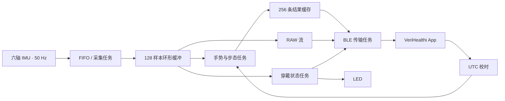

# VESC 2026｜基于六轴 IMU 的腕部动作识别终端

2026 芯原杯嵌入式软件开发决赛项目 · 北京理工大学 · AAA单片机批发队

面向 CocopalmR-VESC 开发板的实时动作识别固件。开发板以 50 Hz 采集六轴 IMU 数据，在端侧运行手势、步态和穿戴状态识别，通过 BLE 将带时间戳的动作结果发给手机 App。运行时使用 C、RISC-V、Nuclei Studio 和 VeriHealthi SDK v3.8 的 RTOS 接口。

[观看决赛现场真机演示（MP4）](https://github.com/peterpark494/vesc2026-imu-wearable/releases/download/showcase-v1/vesc2026-demo.mp4) · [查看 V4.0 的 C 推理移植示例](docs/v4-port.md)

## 我的贡献｜曹昊，队长、嵌入式开发

- **固件集成与联调**：与队友共同完成 SDK 侧开发和真机测试。将采集、识别、穿戴状态与 BLE 传输按任务划分，用事件通知和环形缓冲衔接，避免多个消费者直接争用 IMU FIFO。
- **BLE 数据链路**：调试 App 的控制写入、状态回读和数据通知，区分「已连接」「已开启 RAW」「App 成功解析数据」三个验证点。集成结果序号、CRC-8 和断连缓存，兼容 App 既有的数据格式。
- **算法移植与端侧调参**：配合算法队友，将 Python 模型和事件判定逻辑移植至固件侧 C 模块。根据真机数据调整步态进入/退出判据，排查鼓掌和大幅抬腕误触发步态、慢跑被识别成快走等问题。
- **设备验证**：通过 Tera Term 对照串口采样统计、BLE 状态和 App 界面，定位采集、控制面与数据面的问题。迭代穿戴状态机和 LED 指示，集成看门狗与故障注入入口，生成可供上板验证的 Release 镜像。

离线模型训练和数据处理为团队工作。仓库将团队模型指标与固件联调证据分别标注。

## 固件架构



| 工程模块 | 实现与设计取舍 |
|---|---|
| IMU 采集 | 配置量程、采样率和 FIFO；各消费者维护独立读序号。消费者落后到被覆盖时追到最早仍可用的样本。 |
| BLE 结果包 | 9 字节包头和 11 字节记录。单条结果 20 字节以适配默认 ATT MTU。负载带 CRC-8，通知成功入栈后从结果缓存出队。 |
| 掉线与背压 | 断连期间环形缓存保留结果，连接恢复后尝试补发。队列满时丢弃最旧记录，App 可以结合序号观察缺口。 |
| 时间同步 | 使用手机写入的 UTC 时间与设备单调时钟建立锚点。曾根据特定手机观察值加入固定偏移补偿，该补偿属于校时调试参数。 |
| 识别与穿戴 | 模型输出经事件状态机和阈值过滤。穿戴判断结合 IMU 活动量和连续静止窗口，通过迟滞减少短暂停顿引起的误熄灯。 |

## 验证证据

| 测试 | 数据范围 | 结果 |
|---|---|---|
| Python V4.1 旧六类官方离线回放 | 430 条流，15,020 个标注事件 | Macro-F1 95.75%，整体 F1 95.87% |
| 同批回放，纳入新增动作误报 | 计入 114 次 Double Swipe 误输出 | 整体 F1 95.50% |
| Python V4.1 新动作回放 | 30 条流，1,500 个事件 | Flex F1 90.20%，Double Swipe F1 75.05% |
| Python V4.1 增强流回放 | 216 条流，14,400 个旧六类事件 | 整体 F1 57.63%，旧六类 Macro-F1 61.57% |

指标来自 2026-07-23 的团队离线回放报告。板端识别准确率和端到端时延需要单独测量。不同版本对 Double Swipe 采用过不同配置，V4.1 报告记录的是启用该类别时的回放。

团队也探索了小角度三维旋转、时间轴缩放和通道噪声，用于模拟佩戴角度、动作速度和传感器扰动。表中的 216 条增强流是 V4.1 的独立回放条件。其 F1 明显低于官方流，说明模型对该增强集所覆盖的变化还有改进空间。

## 可运行示例

`tools/check_result_frame.c` 是独立的 C99 结果包检查器，可在电脑检查抓到的 BLE 结果包，打印时间戳、序号和结果码。它只有标准库依赖。

```sh
cc -std=c99 -Wall -Wextra -o check_result_frame tools/check_result_frame.c
./check_result_frame --self-test
```

查看[固件复现与排查步骤](docs/firmware.md)。板端固件依赖单独取得的 VeriHealthi SDK v3.8、对应板卡和团队固件集成文件。仓库提供项目架构、汇总测试结果、独立诊断工具和 C 推理移植示例。
